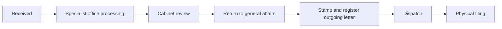
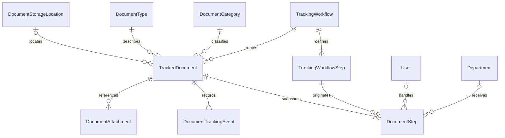

# Document tracking

`/admin/documents` is the authenticated operational register, owned by
`src/features/document-tracking`. It replaces the fixture preview at that route;
the generic fixture proof remains under `features/documents/testing` for tests.
This register is separate from the public downloadable-document catalogue at
`/hrd/documents` and does not change that catalogue or the app-wide footer.

## Initial shared route

The registration form requires a file (up to 32 MB) or an HTTP(S) file URL,
with controls directly below the title. There is no no-attachment or skip option.
Attachment input is validated before creating the record. A single submit
saves the record and then its attachment; success is reported only after both.
The same attachment dialog is available from document details afterward.
Uploads use the NestJS document-scoped multipart endpoint and its R2/scan
policy, deployed from backend PR #3.
An attachment failure preserves the registered record and attachment draft;
retrying saves only the attachment and never repeats document registration.

All document types use one route, as requested. The route definition is stored
in the database and copied into each document's seven stage instances, preserving
the meaning of existing records when future definitions change.

A read-only stepper shows current route progress. An ordered event timeline
shows what actually happened, including repeated passes through a stage.
Handlers explicitly confirm the receiving person on a handoff. Forward moves
one stage; Return requires a reason and an earlier stage. Hold requires a reason,
and Resume is required before movement. Cancellation is restricted to admins.
Dispatch requires an outgoing number; completing physical filing requires a
storage/cabinet code. Reopening a completed document requires an admin Return.
Returning clears downstream stage completion and downstream stamp/dispatch
timestamps, while keeping earlier chronological events.

## Data model

The API repository owns `prisma/schema.prisma`, the additive migration
`20261027120000_document_tracking`, and `src/modules/document-tracking`.
Existing integer User and versioned Department identities are reused. New
document identities use UUIDs; a generated registry number is displayed as
`DOC-000001`. Source system/record identity is reserved for idempotent imports.
Elapsed days are derived from receipt and completion, never stored as a counter.
Attachment records store validated HTTP(S) links, including URLs returned by
the existing R2 upload service. Upload authorization belongs to document
tracking; storage sharing permissions remain with the existing storage system.

Only one stage per document can be ACTIVE (partial unique index). Sequence and
stage position are unique within a document. Mutations claim an expected version
atomically and append an event in the same transaction; stale forms receive 409.
All app history is append-only. Archiving a record hides it from the active list
without deleting its events or attachment links; it is distinct from physical filing.
There is no purge or archive restore endpoint in this initial version.

## Organization and HR integration

Handler choices reuse `User.profile`, `Profile.CurrentEmployment`, and effective
`EmploymentHistory` records. Names, position titles and offices are work-identity
projections; national IDs, salary, birth dates and private contact fields are not
selected. Invalid or expired current-employment shortcuts fall back to effective
assignments belonging to the same profile. Date-only employment windows use the
Cambodia business date. Accounts without profiles remain supported.

Office choices reuse the versioned Department tree and MinistryVersion names,
showing ministry and ancestor context. Future-dated organization names are not
shown as current. On registration/handoff, the service resolves the receiving
handler's HR office unless another receiving office is explicitly chosen; where
no HR assignment exists, it retains the stage's office. The responsible specialist
office is separate from the current receiving office.

Receipt events reference the existing `EmploymentHistory` and `DepartmentVersion`
records and snapshot the receiving office, position and ministry names. Renaming
an office or transferring a handler therefore does not rewrite handling history.
No parallel employee, ministry or department catalogue is introduced, and HR
employment status does not replace session/role/assignment permissions.

## Authorization

All endpoints require the existing Better Auth session. Admin status is resolved
from the current database role, not accepted from client input. Disabled, locked,
banned, deleted and explicitly unactivated accounts cannot use the tracker.

Admins can register/edit/archive documents and update any progress. The current
assigned handler can update progress and add attachment links. Previous handlers
can read records they participated in but cannot update a later handler's stage.
Other authenticated users cannot read arbitrary documents. The list, its count,
and detail reads use the same participation scope (creator, stage assignee or
event recipient). Handlers need authenticated access to this route even though
its URL starts with `/admin`; do not gate the whole page with `useAdminAccess`.

All nine new public-schema tables enable RLS and revoke direct PUBLIC/anon/
authenticated privileges. This app uses Prisma plus Better Auth, rather than
Supabase UUID identities. No permissive `auth.uid()` policy is installed. The
backend's existing database owner/BYPASSRLS role performs these operations and
enforces object permissions in the service; browsers use the guarded API.

## Existing sheet inspection and import mapping

Read-only inspection of `Database!A3:AF` found 2,884 records: 2,862 completed,
22 in progress, 2,874 normal priority and 10 urgent. The migration seeds the
three actual category labels, twelve document-type labels and shared route only.
It does **not** import documents, create fake historical handoffs, or change the
sheet-backed root page. Names and free-text office labels must be mapped to real
users/departments before a later historical import.

| Sheet columns (zero-based) | New representation |
| --- | --- |
| 0 source ID | sourceSystem + sourceRecordId |
| 1 registry number | Preserve legacy reference during import; new generated registrationNumber remains unique |
| 2 status | lifecycle + current stage, validated against observed dates |
| 3 elapsed days, 27 processing days | Derived from receivedAt/completedAt |
| 4 title, 5 priority | title, priority |
| 6 category, 11 type, 12 leave subtype | categoryId, typeId, subtype |
| 7 intake date, 8 intake time | receivedAt (Asia/Phnom_Penh, UTC+7) |
| 9 incoming number | incomingNumber |
| 10 responsible office | responsibleDepartmentId after explicit mapping |
| 13 incoming image, 28 final image | INCOMING/OUTGOING DocumentAttachment links |
| 14 intake receiver | RECEIVED stage handler / historic event, after identity mapping |
| 15 processing, 16 processing date | PROCESSING stage and chronological evidence |
| 17 forwarder, 18 receiver, 19 notes | Handoff actor/recipient snapshots and note |
| 20 cabinet receiver, 21 return date | CABINET_REVIEW / FINALIZATION events, only when evidence exists |
| 22 stamper, 24 stamp date | STAMPING event and stampedAt |
| 23 outgoing number, 25 dispatch date, 26 receiver | outgoingNumber, DISPATCH event, dispatchedAt |
| 29 cabinet, 30 chronological code, 31 archive sequence | storageLocationId, chronologicalCode, archiveSequence |

Historic dates should be parsed explicitly in Cambodia time and ambiguous rows
reported for review. Do not infer missing intermediate events or arbitrarily
match people's names. A future importer should provide a dry run, duplicate
detection via source identity, and a rejected-row report before writing records.

## API and verification

The versioned route is `/api/v1/document-tracking`: GET `metadata`, POST `query`,
GET `:id`, POST registration, PATCH `:id`, POST `:id/progress`, POST
`:id/attachments`, multipart POST `:id/attachments/upload`, DELETE `:id`
(soft archive with expected version and reason).
Query uses the shared DataTable policy/Prisma translator with allowlisted filters,
server pagination/sort/search, deterministic ordering and matching count scope.

Client list/detail/form states use React Query and the shared table policy:
desktop table, mobile cards, filtering, centered search, fullscreen, selection,
manual card flips and content-sized details. Dialogs and dedicated create/edit/
archive routes reuse one form. Open forms retain their original version and draft
on conflict; they never silently retry using a fresh version.

In the API repo, run typecheck, `npm test -- --runInBand`, and
`node node_modules/tsx/dist/cli.mjs --tsconfig tsconfig.seed.json scripts/document-tracking-smoke.ts`.
The smoke test uses the real schema/service and rolls back all sample users,
documents, events and storage. It covers handoff authorization, a stale write,
hold/resume, return, all seven stages, storage, querying and soft archive.
Use the normal Prisma deployment pipeline on other environments; never reset the
database. The development DB migration was applied alone in a transaction after
checking that no unrelated migrations were pending, with a Prisma checksum entry.

## Delegated document authorization closeout

Management (`actor.isAdmin`) includes the explicit manage/TrackedDocument grant. It is separate from `actor.isTrackingAdmin`, which alone permits administrator progress overrides. The client preserves the latter flag; missing flags fail closed. Cancel and completed-document Return require actual tracking-administrator authority, while ordinary assigned handlers retain their active-stage actions.

Attachments have their own `permissions.canAttach`: actual tracking administrators, delegated document managers and the currently assigned active-stage handler may attach files or URL links to unarchived records. Upload preflight and the URL-link transaction use the same rule. The transaction re-reads account/role status and stage assignment before claiming the expected version. Failed linking removes an uploaded object; scan and storage behavior remains in the existing R2 service. Missing attachment permission from an older server fails closed in the client. Deploy the backend before the frontend so delegated managers receive attachment controls.

The additive 20261029090000_document_management_permission migration was verified/applied to target Supabase project jkfyjxttbddnwcpyjrpc on 31 October 2026. Its checksum is 383085eb3a7fdbbdef769969ea8fa4feaa57f727ecbcef77fde5bf10d7c49ef1. Both the permission and successful Prisma history entry were verified; all 15 pre-existing role-grant links remained unchanged. No reset or seed was run.

The cross-repository smoke harness is `pharmacy-api/scripts/tracking-authorization-closeout-smoke.ts`. It bundles this feature's real client API/contract code, calls the actual versioned Nest controller over loopback HTTP with the production validation pipe, and exercises real database/service authorization using disposable actors and documents inside a rollback-only transaction. Only the test identity adapter and external storage/scanner are mocked. It does not claim to verify deployed Better Auth sessions or live R2/VirusTotal. Never run mutation smoke tests against existing operational documents.
